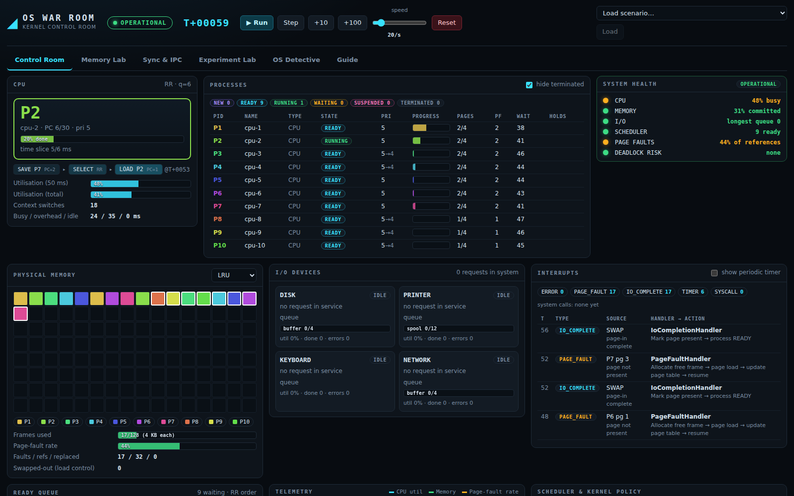
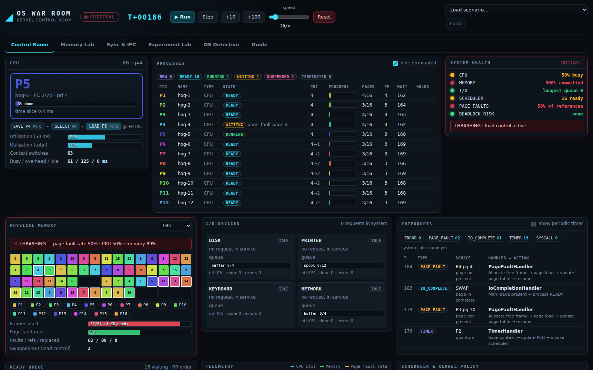
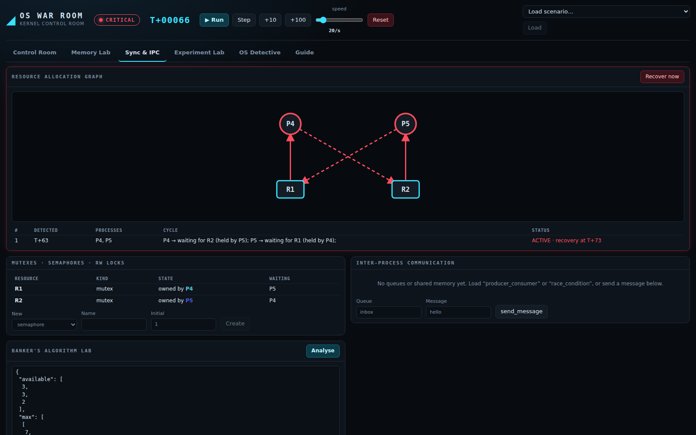
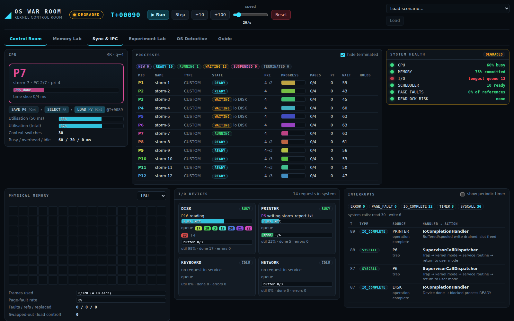
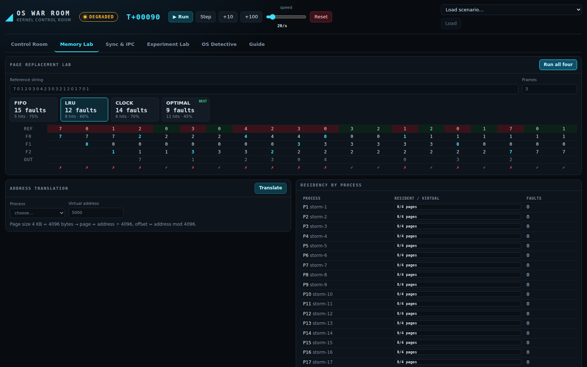
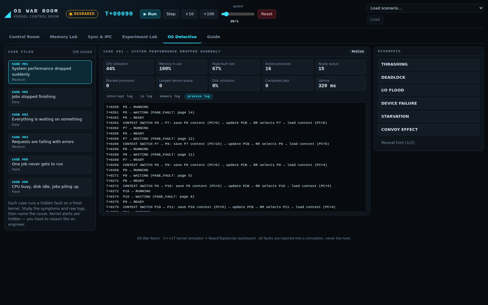

# OS WAR ROOM

**An Interactive Multiprogramming Operating System Simulator for Workload Management, Failure Injection and Kernel Recovery**

> *Create. Run. Break. Diagnose. Recover.*

OS War Room is a C++17 kernel simulator with a live React/TypeScript control-room dashboard. Instead of showing each Operating Systems algorithm in isolation, it runs a small multiprogramming OS in which scheduling, context switching, interrupts, system calls, virtual memory, synchronisation, IPC, I/O buffering/spooling and error handling all **interact** — and lets the evaluator create processes, inject failures, watch the kernel detect and recover, and compare algorithms on identical workloads.

| | |
|---|---|
| **Kernel engine** | C++17, header-centric, dependency-free (`kernel/`, `simulation/`) |
| **API + web server** | dependency-free HTTP/1.1 server with JSON API (`dashboard/backend/`) |
| **Dashboard** | React 18 + TypeScript + Vite (`dashboard/frontend/`, pre-built in `dist/`) |
| **Tests** | 87 tests / 2 036 assertions, clean under AddressSanitizer + UBSan |
| **Scenarios** | 11 JSON scenario files (`scenarios/`) |

## Quick start

```bash
make                 # builds build/owr_server, build/owr_cli, build/owr_tests   (or: cmake -S . -B build && cmake --build build)
make test            # runs the 87 tests
make run             # starts the server -> open http://127.0.0.1:8080
```

The dashboard is already built into `dashboard/frontend/dist`, so **no Node.js is needed to run it**. To modify it:

```bash
cd dashboard/frontend && npm install && npm run build      # or `npm run dev` (proxies /api to :8080)
```

Requirements: a C++17 compiler (g++ ≥ 9 / clang ≥ 10), GNU Make or CMake ≥ 3.14, Linux/macOS (or WSL on Windows). Developed and tested with g++ 13 on Ubuntu 24.04.

## What you can do

* **Control Room** — run / pause / step / speed; create processes (CPU-bound, I/O-bound, memory-intensive, interactive, or a custom program in the built-in assembly); watch the CPU, process table, ready queue, PCB inspector, frame map, I/O devices, interrupt queue, system health and the categorised kernel event log; switch scheduler, quantum, replacement policy and recovery policy **live**.
* **Failure Lab** — force a page fault, exhaust memory, create a deadlock, crash a process, flood the I/O queue, fail a device, stress the buffers, start a starvation scenario. The kernel detects (thrashing, deadlock, starvation, device failure, crash) and recovers (load control, victim termination/rollback, EIO propagation, resource cleanup).
* **Memory Lab** — reference-string lab (FIFO / LRU / Clock / Optimal side by side with step tables), virtual→physical address translation.
* **Sync & IPC** — live Resource Allocation Graph, mutexes / semaphores / reader-writer locks, message queues, shared memory, Banker's algorithm lab.
* **Experiment Lab** — run the *same seeded workload* under 7 schedulers and 4 replacement policies; what-if sweeps over process count, quantum, memory size, page size and I/O intensity.
* **OS Detective** — six generated case files (symptoms + raw logs, kernel alerts hidden); name the hidden cause.
* **Guide** tab — a 10-minute evaluator walk-through and the health/thrashing thresholds.

## Screenshots

| | |
|---|---|
|  |  |
|  |  |
|  |  |

## Predefined scenarios (`scenarios/*.json`)

| File | Demonstrates |
|---|---|
| `cpu_heavy` | Scenario 1 — CPU Battle: Round Robin, timer interrupts, context-switch overhead |
| `memory_pressure` | Scenario 2 — Memory Meltdown: page-fault storm, thrashing detection, load control |
| `io_flood` | Scenario 3 — I/O Storm: device queues, buffer-full producer blocking, printer spool |
| `deadlock` | Scenario 4 — Deadlock Trap: cycle detection, victim selection, recovery |
| `fault_recovery` | Scenario 5 — Process Crash: error interrupt, crash dump, cleanup, lock hand-off |
| `producer_consumer`, `race_condition`, `dining_philosophers` | semaphores, shared-memory race, circular wait |
| `mixed_workload`, `starvation`, `convoy` | MLFQ on a mixed workload, priority starvation/aging, FCFS convoy effect |

Run any of them headless: `./build/owr_cli scenario scenarios/deadlock.json --log`

## Repository layout

```
kernel/            the simulated OS
  common/          types, config, JSON, logger, RNG
  process/         PCB, instruction set, assembler, program generators
  scheduler/       FCFS, SJF, SRTF, RR, Priority(+aging), MLFQ, Adaptive
  memory/          frames, page tables, demand paging, FIFO/LRU/Clock/Optimal
  interrupts/      interrupt controller (sync traps, async priority queue)
  synchronization/ mutex, semaphore, RW lock, wait-for-graph deadlock detection, Banker
  ipc/             message queues, shared memory
  io/              devices, write-behind buffers, printer spooler, failure/repair
  errors/          crash dumps
  kernel.cpp       dispatcher, syscalls, handlers, recovery, health, metrics
simulation/        Simulation controller, scenario loader, Failure Lab, workload generator,
                   Experiment Lab, OS Detective
dashboard/         backend (C++ API server) + frontend (React/TypeScript)
scenarios/         predefined demo scenarios
tests/             unit + integration tests, API smoke test
tools/             owr_cli (headless scenarios, experiments, what-if, replacement lab)
docs/              architecture, module docs, user guide, technical docs, report, results
```

## Documentation

[Architecture](docs/ARCHITECTURE.md) · [Module documentation](docs/MODULES.md) · [User guide](docs/USER_GUIDE.md) · [Technical documentation](docs/TECHNICAL.md) · [Testing](docs/TESTING.md) · [Performance experiments](docs/EXPERIMENTS.md) · [Requirements traceability](docs/REQUIREMENTS_TRACEABILITY.md) · [Final report](docs/FINAL_REPORT.md) · [Presentation](docs/OS_War_Room_Presentation.pptx)

## Scope and honesty notes

This is an **educational simulation**. All failures are injected into the simulated kernel, never the host. Time is discrete (1 tick = 1 simulated ms) on a single simulated CPU. Memory sizes are in KB (default 256 KB / 4 KB pages = 64 frames) so the frame map stays legible; the engine itself is scale-free. See [docs/TECHNICAL.md §Limitations](docs/TECHNICAL.md#limitations-and-assumptions) for the full list of modelling assumptions.

## License

MIT — see `LICENSE`.
